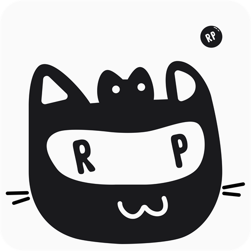

<p align="center">
  
</p>

<h1 align="center">AturMyDuit</h1>

<p align="center">
  Catat duit, atur kantong, dan pahami ke mana uangmu pergi — sepenuhnya di perangkatmu.
</p>

<p align="center">
  <a href="https://github.com/s4ndrism/AturMyDuit-App/releases/latest"></a>
  <a href="https://github.com/s4ndrism/AturMyDuit-App/releases"></a>
  
  
  <a href="LICENSE"></a>
  <a href="https://github.com/s4ndrism/AturMyDuit-App/stargazers"></a>
  <a href="https://github.com/s4ndrism/AturMyDuit-App/forks"></a>
</p>

---

**AturMyDuit** adalah aplikasi pencatat keuangan pribadi yang **local-first**.
Transaksi, kantong, budget, dan tagihan tersimpan di HP-mu lewat SQLite — tanpa
akun, tanpa server, dan tetap jalan offline. Tersedia dalam **Indonesia** dan
**English**, dengan tema terang, gelap, atau mengikuti sistem.

## Fitur

- **Kantong** — bank, e-wallet, investasi, cash, dan tipe kustom, dengan saldo
  yang dihitung dari ledger.
- **Kategori** — kategori bawaan dan custom, dipisah pemasukan/pengeluaran,
  bisa diurutkan dan diarsipkan.
- **Transaksi** — pemasukan, pengeluaran, dan transfer antar kantong lengkap
  dengan biaya admin.
- **Budget** — batas pengeluaran per kategori dan keseluruhan, dengan progres
  pemakaian.
- **Tagihan** — siklus harian, mingguan, bulanan, atau tahunan, auto-pay, dan
  pengingat H-24.
- **Analitik** — grafik arus duit, komposisi pengeluaran, dan filter rentang
  waktu, kantong, serta kategori.
- **Backup & restore lokal** — snapshot database dengan validasi, safety
  snapshot, dan rollback.
- **Profil lokal** — nama dan foto tanpa login.
- **Dua bahasa** — Indonesia dan English, bisa mengikuti bahasa sistem.
- **Tema** — terang, gelap, atau mengikuti sistem.

> Semua fitur yang tampil di aplikasi 1.0.0 sudah berfungsi penuh.

## Screenshot

<!-- Placeholder: ganti dengan gambar asli di folder screenshots/ saat rilis. -->

Screenshot aplikasi akan ditambahkan saat rilis 1.0.0 dipublikasikan.

## Unduh & pasang

1. Buka halaman [rilis terbaru](https://github.com/s4ndrism/AturMyDuit-App/releases/latest).
2. Unduh file `AturMyDuit-*.apk` beserta `SHA256SUMS.txt`.
3. Izinkan pemasangan dari sumber tidak dikenal di pengaturan Android, lalu
   buka APK-nya.
4. Verifikasi checksum bila perlu:

   ```bash
   sha256sum AturMyDuit-*.apk
   ```

   Di Windows PowerShell:

   ```powershell
   Get-FileHash AturMyDuit-*.apk -Algorithm SHA256
   ```

APK hanya tersedia untuk **Android**. Data tersimpan lokal; tidak ada akun yang
perlu dibuat.

## Bantuan & laporan bug

- Ada pertanyaan atau menemukan bug? Buka
  [issue](https://github.com/s4ndrism/AturMyDuit-App/issues).
- Sertakan versi aplikasi (Tentang Aplikasi), tipe HP, dan versi Android.
- Jangan lampirkan data transaksi pribadi atau file backup ke issue publik.

## Privasi & data

AturMyDuit tidak mengirim transaksi ke server mana pun. Semua data berada di
database lokal di perangkatmu. Backup lokal membuat salinan database di
penyimpanan yang kamu pilih. Kamu bertanggung jawab menjaga file backup sendiri.

## Dukung pengembang

AturMyDuit gratis dan dikembangkan di waktu luang. Kalau aplikasi ini
membantu, kamu bisa traktir pengembang lewat
**[Trakteer](https://trakteer.id/s4ndrism)** — tidak wajib, dan semua fitur
tetap terbuka tanpa donasi.

## Lisensi

AturMyDuit adalah perangkat lunak **proprietary**.

- Gratis dipakai untuk keperluan **pribadi dan non-komersial**.
- Dilarang menjual, mengubah, atau mendistribusikan ulang aplikasi tanpa izin.
- Source code privat dan tidak dilisensikan untuk umum. Repositori ini hanya
  memuat rilis APK dan dokumentasi pengguna.
- Penggunaan komersial atau lisensi khusus: hubungi
  [@s4ndrism](https://github.com/s4ndrism).

Ketentuan lengkap ada di [`LICENSE`](LICENSE) (Indonesia) dan
[`LICENSE.en`](LICENSE.en) (English). Aplikasi menampilkan versi sesuai bahasa
yang dipilih.

## Kredit

Dikembangkan oleh [@s4ndrism](https://github.com/s4ndrism).

Dibangun dengan Flutter & Dart, Drift + SQLite, Riverpod, go_router, fl_chart,
intl, flutter_local_notifications, timezone, uuid, clock, crypto, path_provider,
image_picker, file_picker, camera, sqlite3, dan Montserrat (SIL Open Font
License). Terima kasih kepada komunitas di balik tools dan library tersebut.
